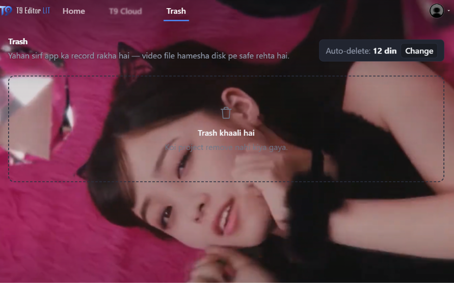

# My media vs. the timeline — the rule that was missing

Reference screenshot: [`ui-review-screenshots/13-my-media-empty-timeline.png`](ui-review-screenshots/13-my-media-empty-timeline.png)



That picture is the whole feature. A 37-minute recording sits in **My media**,
the stage is black and the timeline says **"Drag & drop media here"** — because
nothing has been put on the timeline yet. Browsing your media and editing your
video are two different acts.

Our app did not behave like that. It had two bugs that looked like one:

| What the user saw                                 | What was actually happening                                                                                                                                    |
| ------------------------------------------------- | -------------------------------------------------------------------------------------------------------------------------------------------------------------- |
| "Old media / old project's media dikhai deti hai" | `media.entries` was one **global** list for the whole session. Opening project B kept A's imports in My media, because nothing ever scoped it.                 |
| "Video aapne aap timeline par aa jati hai"        | Importing, dropping a file, or **clicking a tile** could silently adopt the file as the project source, which is the same thing as putting it on the timeline. |

Both are one missing sentence in the model: **the library is per project, and
only the user puts media on the timeline.**

---

## 1. The model

```text
   disk / vault / yt-dlp
            │  Import  (any source)
            ▼
   ┌──────────────────┐        drag / + / double-click        ┌──────────────────┐
   │     My media     │ ────────────────────────────────────► │     Timeline     │
   │ (this project's  │                                       │ (clips, in order)│
   │  files: paths +  │ ◄──── never automatic ─────────────── │                  │
   │  metadata only)  │                                       │                  │
   └──────────────────┘                                       └──────────────────┘
            │                                                          │
            └──────────── switches with the project ───────────────────┘
```

Two stores, two jobs:

- **`lib/stores/media.svelte.ts` — the library.** A list of `MediaEntry`
  (path, name, duration, size, poster). It holds **paths, never bytes**. Its
  scope is the open project, so it is saved under
  `localStorage["t9.media.<project>"]` as a small JSON array — the same pattern
  the project's extra clips and cut order already use. No SQLite migration, no
  heap, and a 5 GB file costs the same as a 5 MB one.
- **`lib/stores/project.svelte.ts` — the timeline.** The project's source plus
  its extra clips. `clips[]`, `editDuration`, `sequenceAt()` and the export
  sequence all live here.

### Invariants (the part to keep true)

1. **No project = no library.** The dashboard never shows another project's
   media; a new project starts with an empty My media.
2. **Import is not an edit.** `importPaths()` / `importBlobs()` only append to
   the library. They never touch `project.media`, `project.clips`, the
   transcript or the playhead.
3. **One door onto the timeline.** Only `project.placeAsset(id)` — called by
   the tile's **+**, a **double-click**, a keyboard **Enter**, or a **drop on
   the lane**. A plain click is a selection.
4. **The first clip makes the project.** Drop a clip into a project that has no
   source and it becomes the project's video (so Cut, transcript and Phantom
   Cut have something to work on). Every later drop is appended after the cut.
5. **Switching projects switches the library.** Including the browser demo.

### What an empty project looks like now

- stage: "Koi video nahi khuli…" (or the real load error)
- My media: the imported tiles, nothing else
- timeline: a dashed lane — **Drag & drop media here · My media se clip kheencho ya + dabao**
- transport: `0:00.00 / 0:00.00`

Which is exactly the reference screenshot.

---

## 2. What actually caused it (file by file)

### 2.1 The library was global

`MediaStore.entries` had no owner. `loadFromBackend()` added the source,
`importPaths()` added the imports, and nothing ever removed the previous
project's entries. `startNew()` cleared `project.media` and the clips but left
`media.entries` alone — so "Khaali Project" showed the old project's files.

Fix: `media.enterScope(key)` with

- `startNew()` → `media.startDraft()` — a fresh, empty library;
- `loadFromBackend(path)` → `media.enterScope(canonicalPath)`;
- `loadBaked()` → `media.enterScope(baked.url)` (the browser demo);
- a draft that gains its source **carries** its entries (`carryDraft`) — it is
  the same project, now with a file;
- every mutation goes through `MediaStore.set()` → `entries` + `persist()`.

`inUse` is **not** persisted: it is recomputed when the project loads, so a
restored tile can never claim to be the current source.

### 2.2 A click used to be an import

The tile had `onclick={() => addToTimeline(e.asset.id)}`. That is a trap: you
click a tile to look at it, and a clip appears at the end of the timeline.

Fix: `onclick` selects; `ondblclick` / **+** / Enter / drop place. The `+`
button was already there — it is now the visible way, and the empty lane names
the gesture.

### 2.3 Import used to adopt the file

`importPaths()` ended with _"no project open: the last file becomes the one
being edited"_, and `importBlobs()` did the same. That is how a video "jumped"
onto the timeline after **New project → Import media**.

Fix: both are library-only. The explicit "create a project from this file"
paths stay explicit:

| Path                                                      | Result                                          |
| --------------------------------------------------------- | ----------------------------------------------- |
| Create project → **This PC** / **Video link**             | the chosen file **is** the project (source)     |
| Create project → **Khaali Project** → Import media        | library only, empty timeline                    |
| Media panel → **Import media**                            | library only, open project unchanged            |
| Dashboard → **Import media**                              | new draft project, library only, empty timeline |
| Drag & drop a file (editor or dashboard)                  | library only (dashboard: a new draft project)   |
| **Click** a tile                                          | selection only                                  |
| **+** / **double-click** / **Enter** on a tile, or a drop | the one door onto the timeline                  |

### 2.4 A transcript-less project had an invisible timeline

`segments` was `buildSegments(lines)`, so a project whose transcript had not
been generated yet showed **nothing** on the lane while the ruler spanned the
whole file. A video could be open and look absent.

Fix: when there are no transcript lines but there is a source, the timeline
shows the source as one full-length clip (`id: "seg-source"`). The transcript
retakes the lane as soon as it exists; "all clips cut" still shows nothing.

---

## 3. Why this is the right shape for this app

- **Zero-RAM (§1 of AGENTS.md).** The library is a JSON of paths. The `<video>`
  streams the file; FFmpeg reads it in short-lived children. Nothing about
  scoping adds a byte of media to the heap.
- **One project, many assets.** The project keeps _references_. A clip is
  `{path, url, inSec, outSec}`; duplicating or reordering it never copies a
  file.
- **No mystery state.** The only way media reaches the timeline is a gesture
  the user made. Undo/redo and the transcript can never be surprised by a clip
  that "appeared".
- **The dashboard is the project list.** A project without a source has no
  SQLite row and no card — correct, because a library alone is not a project
  yet; the first dropped clip creates it.

---

## 4. How to verify (2 minutes)

1. `npm run dev` → localhost:5174 → **New project → Khaali Project → Project
   banao**. My media is empty, the lane says _Drag & drop media here_.
2. Drop a video (or **Import media** on the desktop). The tile appears; the
   timeline **does not change**. ← the two bugs, both fixed.
3. **Click** the tile: it gets a ring, nothing is added. **Double-click** / **+**:
   the project name becomes the file name, the video becomes the source and one
   clip covers it.
4. Go Home → open another project. My media shows **that** project's media only.
   Go Home → New empty project: My media is empty again.
5. `npm run check` → 0 errors, `npm run test` → 26/26.

## 5. Files this rule lives in

| File                                                     | Role                                                             |
| -------------------------------------------------------- | ---------------------------------------------------------------- |
| `src/lib/stores/media.svelte.ts`                         | scoped library, persistence, `failed`/`renamed` helpers          |
| `src/lib/stores/project.svelte.ts`                       | `enterScope` calls, draft carry-over, `placeAsset`, `seg-source` |
| `src/lib/components/media/MediaPanel.svelte`             | click = select; + / double-click = place                         |
| `src/lib/components/cut/WaveTimeline.svelte`             | drop = place; Clipchamp-style empty lane                         |
| `src/lib/components/DropOverlay.svelte`                  | dashboard drop makes a new draft, editor drop is library-only    |
| `src/lib/components/dashboard/HomeDashboard.svelte`      | dashboard import starts a new draft                              |
| `src/lib/components/dashboard/CreateProjectModal.svelte` | "This PC" makes the first file the project (explicit, by design) |
