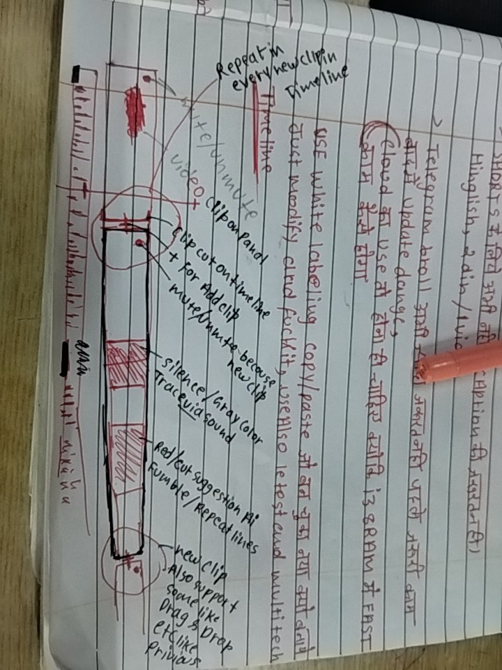

# The handwritten timeline diagram — decoded, and where the app stands

Source drawing: [`resource_Clipchamp/humanDigramofTimeline.jpg`](../resource_Clipchamp/humanDigramofTimeline.jpg)
(byte-identical copy for the docs:
[`ui-review-screenshots/14-timeline-human-diagram.jpg`](ui-review-screenshots/14-timeline-human-diagram.jpg))



The page is a notebook shot sideways: the Hindi notes run along the page's long
edge and the timeline is a long horizontal bar with red hatched blocks. This
document decodes every label, redraws the bar as ASCII, and maps each request
onto the code that exists today — so nobody has to read handwriting twice.

---

## 1. What the page says (transcription)

### 1.1 The notes above the drawing

| Handwriting                                                                           | Meaning                                                                                  |
| ------------------------------------------------------------------------------------- | ---------------------------------------------------------------------------------------- |
| "SHORTS के लिए ज़्यादा से ज़्यादा caption लगा देना (Hinglish, 2 din / vid)"           | For Shorts, put as many captions as possible; Hinglish; budget ~2 days per video.        |
| "Telegram bot से जो भी करना है, पहले मेरे पास update dunga"                           | Anything to do with the Telegram bot: check with me first.                               |
| "Cloud का use नहीं होगा अभी — पहले सबको मिलके i3 8GB में FAST चलेगा" (circled)        | **No cloud for now.** First make it fast on the i3 / 8 GB box — the Zero-RAM rule of §1. |
| "USE white labeling copy/paste… just modify… use also letest [latest] and multi tech" | White-label what already exists, modify it rather than build new; use the latest stack.  |

The circled cloud line is the same constraint as `AGENTS.md` §1: everything the
timeline draws must come from local FFmpeg output and SQLite, never a cloud
round-trip.

### 1.2 The labels on the drawing

Read left to right along the bar:

| Label                                                          | What it asks for                                                               |
| -------------------------------------------------------------- | ------------------------------------------------------------------------------ |
| **whole video**                                                | The whole recording is one strip in the timeline, from 0:00 to the end.        |
| **video / clip in panel**                                      | The preview on the left is the same clip the timeline is showing.              |
| **clip cut on timeline + for add clip**                        | Cut points live on the bar; a **+** adds another clip.                         |
| **mute/volume too because new clip**                           | Every clip carries its own mute **and** volume, because it is a separate clip. |
| **silence / gray color trace via sound**                       | Silences are drawn **grey**, derived from the audio (waveform), not guessed.   |
| **auto cut suggestion AI fumble / Repeat lines**               | The AI proposes cuts for fumbles and repeated lines, not only for silence.     |
| **new clip also support drag & drop etc like previews**        | New clips arrive by drag & drop, with the same previews as the main video.     |
| Vertical: **Repeat in every new clip / in every new timeline** | The same timeline model in every project — no per-project variant.             |
| Vertical: **Resize every clip**                                | Clip edges resize (trim), and the lanes themselves resize.                     |
| Vertical: **start/end**                                        | Every strip has a start and an end handle.                                     |

### 1.3 The bar, redrawn

```text
                        ┌ whole video ──────────────────────────────────────────────┐
   ◉ start              │                                                           │              ◉ end
   ├────────────────────┼───────────┬───────────────┬───────────────┬───────────────┼──────────────┤
   │  video (clip)      │  cut ▨▨▨  │   keep        │  cut ▨▨▨▨▨    │  silence ░░░  │  + add clip  │
   └────────────────────┴───────────┴───────────────┴───────────────┴───────────────┴──────────────┘
        │                    │               │               │              │              │
     preview            fumble/repeat   drag & drop      resize        grey from       new clip
                        (AI suggestion)   new clip        handle        the audio       (drop / +)

   ▲ scroll / zoom in-out ────────────────────────────────────────────────────────►
```

The important shape: **one track**, one strip per clip, cut spans hatched red,
silence grey, AI suggestions overlaid rather than a separate panel.

---

## 2. Where each request lives today

The timeline is
[`Clipchamp_Bunny/src/lib/components/cut/WaveTimeline.svelte`](../Clipchamp_Bunny/src/lib/components/cut/WaveTimeline.svelte)
(canvas lanes + clip layer) fed by
[`stores/project.svelte.ts`](../Clipchamp_Bunny/src/lib/stores/project.svelte.ts).

| Sketch request                 | Today                                                                                                              | Status |
| ------------------------------ | ------------------------------------------------------------------------------------------------------------------ | ------ |
| Whole video as one strip       | `project.orderedSegments` + `offsets`; a transcript-less project falls back to one `seg-source` span               | ✅     |
| Start / end handles            | `onTrimDown(edge: 'start' \| 'end')` per clip; the first/last clip is the video's start/end                        | ✅     |
| Cut points on the bar          | Split at playhead (`doSplit`, `project.splitAt`), red hatched spans                                                | ✅     |
| **+ to add a clip**            | Media panel `+` / double-click / Enter, or drop on the lane (`onLaneDrop`)                                         | ✅     |
| Mute per clip                  | `project.toggleSegmentMute` → `isSegmentMuted`; lane alpha 0.28 when muted; Ctrl-menu item                         | ✅     |
| **Volume per clip**            | only mute exists — no gain value, no slider                                                                        | ❌     |
| Silence in grey from audio     | `colours` paints `flag === 'silence'` as `#4a4d5c`; waveform drawn from `project.waveform`                         | ✅     |
| AI suggestions on the bar      | `project.liveSuggestions` painted green on lanes + minimap, Apply/Reject banner                                    | ✅     |
| AI fumble / repeat lines       | flagging happens at import (Gemini); flagged lines arrive **already cut** (red). The AI button scans silences only | ⚠️     |
| Drag & drop new clips          | `onLaneDrop` → `project.placeAsset` (asset drag from My media)                                                     | ✅     |
| Same timeline in every project | one component, scoped library (`docs/MEDIA_LIBRARY_TIMELINE.md`)                                                   | ✅     |
| Resize clips / lanes           | trim handles; lane heights from `layout.timelineHeight` (drag the separator)                                       | ✅     |
| Scroll / zoom                  | `player.zoom`, wheel zoom, scroll-synced ruler, minimap                                                            | ✅     |

So the sketch is **~90 % built**. The remaining diffs are small and concrete.

---

## 3. The three real gaps (and how to close them)

### 3.1 Per-clip volume

The sketch says _mute/volume too because new clip_. `mutedSegments` is a
`string[]` of clip ids; there is no gain.

**Shipped (preview half):** `segmentVolume` in `project.svelte.ts` (a
`Record<clipId, 0..1>`, 1 = original), persisted with the rest of the timeline
UI state, carried through split/merge/delete, applied by `VideoPreview` to the
`<video>` element, and offered on the clip's context menu (100 / 75 / 50 / 25 %)
with a `%` badge on the clip when it is not 100 %. It is a number in state —
nothing is re-encoded, so the Zero-RAM rule is untouched.

**Still open (export half):** `ExportRequest.segments` carries only
`{ start, end }`, and `src-tauri/src/export.rs` has no volume filter, so **a
muted or turned-down clip still exports at full volume**. The menu says
"Preview only — export audio abhi unchanged" because that is the truth.
Closing it needs: `mute`/`gain` on the Rust `Segment`, `-af volume=<g>` on the
pieces that carry audio, and `audio_copied = false` for the whole export as
soon as any segment asks for a gain (a stream copy cannot apply a filter).

### 3.2 AI suggestions for fumble / repeat lines

The sketch wants _auto cut suggestion AI fumble / Repeat lines_, but
`autoSuggest()` calls `project.suggestSilences()` only.

- Add `findAiCuts(minSecs)` = `findSilences()` **plus** the spans of lines with
  `flag` `fumble` / `repeat` that are still `keep`.
- Stage them in the same `project.suggestions` list — the green preview,
  Apply/Reject banner and minimap already understand a `SilenceRange[]`.
- Product decision to make first: a line the **user** pressed `V` on also has
  `flag: 'fumble'`, and re-suggesting it would fight the user. Either record a
  `manual` bit on the line, or only suggest flags with `confidence < 0.7`.

### 3.3 Project-level in/out

"start/end" is satisfied per clip, but there is no single "use only 0:12–4:30
of this recording" control. A project-level `inSec/outSec` would be a new field
on the source and would have to reach the export filter graph — do it with
3.1, in the same export change.

---

## 4. What _not_ to break

- The bar is one `<canvas>` for the waveform/filmstrip plus an absolutely
  positioned clip layer. Painting is driven by `$effect` dependencies
  (`project.suggestions`, `colours`, `zoom`, `contentW`, `LANES_H`); a new
  visual must be added to that list or it will not repaint.
- `project.orderedSegments` is the single source of order — the minimap, the
  export sequence and drag-to-reorder all read it. Never compute order twice.
- Cuts are **phantom**: flipping `keep` never touches the file. Volume must
  follow the same rule — a number in state, never a re-encoded copy.
- Zero-RAM: no decoded frames in the heap. Thumbnails are ~1 fps JPEGs on disk,
  the waveform is a peak array.

## 5. Verification (when 3.1–3.3 land)

1. Split a clip, set its volume to 40 % → preview is quieter **only** in that
   clip; muted clip is silent.
2. Export → the file's audio matches the preview (this is the part that is
   missing today).
3. AI button → green spans include fumbles/repeats; Reject leaves the timeline
   untouched; Apply turns them red and closes the gaps.
4. `npm run check`, `npm run test`, then the deploy contract in `AGENTS.md` §10.
